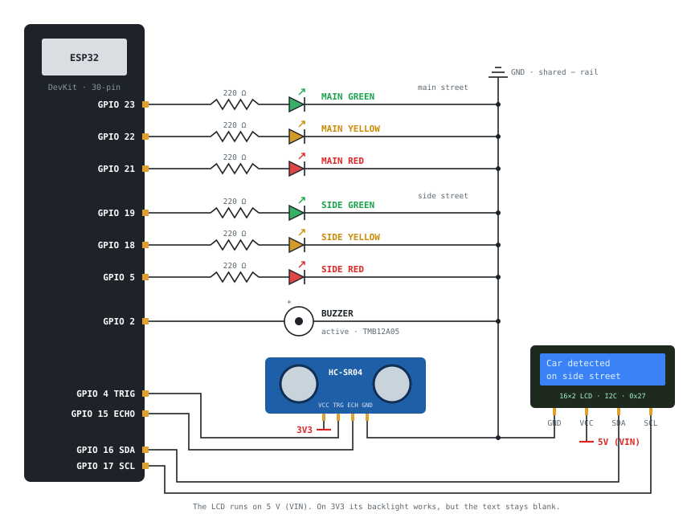

# Sensor-Triggered Traffic Light Controller

An intersection with a **main street** and a **side street**, built on a breadboard with an ESP32 and programmed in C++ (Arduino IDE, board: **ESP32 Dev Module**).

The main street stays green until an **HC-SR04 ultrasonic sensor** detects a car waiting on the side street. Then the buzzer beeps twice, a **16×2 LCD** shows a message, and the lights run a full cycle with all-red safety buffers.

▶ **Watch the full video and try the interactive simulation:** [rayan-rehou.netlify.app/#smartlight](https://rayan-rehou.netlify.app/#smartlight)

## How it works

| Step | Main | Side | Time | LCD |
|---|:---:|:---:|---|---|
| Waiting for a car | 🟢 | 🔴 | until a car is detected | Side Street / is clear |
| Car within 5 cm | 🟢 | 🔴 | 2 beeps, then 1 s | Car detected / on side street |
| Main yellow | 🟡 | 🔴 | 3 s | |
| All red (safety) | 🔴 | 🔴 | 2 s | |
| Side green | 🔴 | 🟢 | 6 s | |
| Side yellow | 🔴 | 🟡 | 3 s | |
| All red (safety) | 🔴 | 🔴 | 2 s | |
| Main green again | 🟢 | 🔴 | at least 10 s | Side Street / is clear |

## Hardware

- ESP32 DevKit (30-pin)
- 6 LEDs (green, yellow, red for each street), each with a 220 Ω resistor to GND
- HC-SR04 ultrasonic sensor (runs on 3.3 V)
- Active buzzer (TMB12A05)
- 16×2 LCD with an I2C backpack (PCF8574, address `0x27`)

## Wiring

| Part | ESP32 pin |
|---|---|
| Main green / yellow / red | 23 / 22 / 21 |
| Side green / yellow / red | 19 / 18 / 5 |
| Buzzer | 2 |
| Sensor Trig / Echo | 4 / 15 |
| Sensor VCC | 3V3 |
| LCD SDA / SCL | 16 / 17 (`Wire.begin(16, 17)`) |
| LCD VCC | VIN (5 V) |
| All GND | shared − rail |

## Schematic

## How the sensor measures distance

1. The ESP32 sends a 10 µs HIGH pulse on **Trig** to start a measurement.
2. The sensor holds **Echo** HIGH for the sound's round-trip time.
3. `pulseIn(Echo, HIGH, 30000)` measures that time in µs, and `distance = duration / 58` converts it to cm.
4. A result of `0` means no echo, which is why the condition is `distance > 0 && distance <= 5`.

## Bugs I fixed

| Problem | Fix |
|---|---|
| LEDs were on GPIO 21/22, the ESP32's default I2C pins | Moved the LCD to GPIO 16/17 with `Wire.begin(16, 17)` |
| LCD backlight on, but no text | An I2C scanner found the LCD at `0x27`, so the wiring was fine. The LCD was on 3.3 V; powering it from 5 V (VIN) fixed it |
| LCD flickering | Stopped calling `lcd.clear()` on every loop |
| The two beeps merged into one | Added `delay(200)` between the beeps |

## Run it

1. Install the **LiquidCrystal_I2C** library in the Arduino IDE.
2. Select the board **ESP32 Dev Module**.
3. Open [`Smart_Traffic_Light.ino`](Smart_Traffic_Light.ino) and upload it.

The code uses `delay()`, so the sensor is not read while a light cycle is running.
